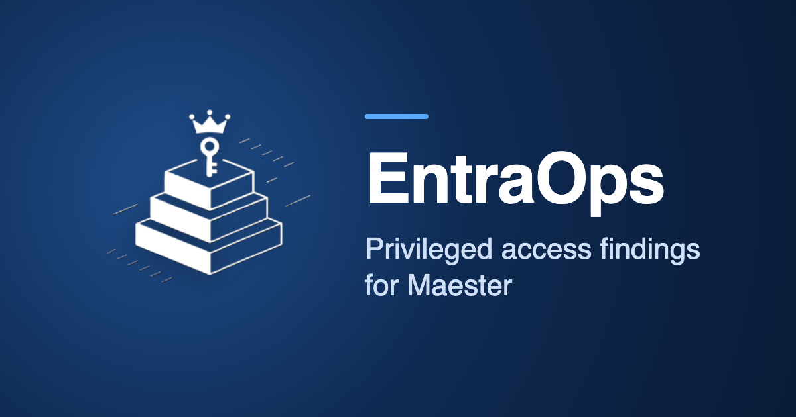

# EntraOps Maester Pack



Shows the [EntraOps](https://github.com/Cloud-Architekt/EntraOps) findings on privileged access as
[Maester](https://maester.dev) tests: Enterprise Access Model tier breaches, standing access, account
protection, workload and agent identities, PIM activation and approval, access packages, access drift from
access packages (Access Guardian) and changes between snapshots.

EntraOps evaluates its finding rules and saves the results to `findings.json` (`Invoke-EntraOpsAssessment` or
`New-EntraOpsReportingData`). This pack reads that file and reports one Maester test per rule:
`MP.EOPS.<n>` for the EntraOps rule `EO.<n>`. The EntraOps reports use the same evaluation, so Maester and the
reports show the same results. The pack evaluates nothing itself and needs no connection, no permission and no
module (`Test-MtPack`: Low risk).

> [!NOTE]
> Maester Packs need Maester 3.0 or later.

<!-- insiders:start -->
> [!IMPORTANT]
> **Internal pack.** This repository is private, and the pack is distributed only through it: only people and
> pipelines with read access to the repository can install the pack and open its links (the Docs page of each
> test). The pack is not published to the Maester Packs index.
>
> - EntraOps 1.2.0 is not on the PowerShell Gallery yet (it has 1.1.0, without findings). Import the module from
>   a clone of the EntraOps Insiders repository: `Import-Module ./EntraOps/EntraOps.psd1`.
> - Maester 3.0 is a prerelease: `Install-PSResource -Name Maester -Prerelease -Repository PSGallery -Scope CurrentUser`.
>   The checks of this repository use the newest Maester; the pack's menu in the report needs 3.0.0-rc56 or later.
> - Install the pack with a GitHub token that can read this repository. Maester sends the token to
>   `api.github.com` only and, for a private repository, sends nothing to Maester Packs (no install event).
>   Without a token, GitHub answers that the repository does not exist. Before the first release, install `main`:
>
>   ```powershell
>   $env:GH_TOKEN = gh auth token
>   # The newest release
>   Install-MtPack Cloud-Architekt/EntraOps-Insiders-MaesterPack
>   # Before the first release, or a release younger than the install cooldown (72 hours)
>   Install-MtPack Cloud-Architekt/EntraOps-Insiders-MaesterPack@main -IncludeRecent
>   # Or from a clone of this repository
>   Install-MtPack ./EntraOps-Insiders-MaesterPack
>   ```
>
> - In a pipeline, `Restore-MtPack` needs the token as well. The `GITHUB_TOKEN` of a GitHub Actions workflow reads
>   only the repository of the workflow, so store a fine-grained token with read access to the contents of this
>   repository (or a GitHub App token) as a secret, and pass it as `GH_TOKEN`.
> - The pack code `EOPS` is not registered in the Maester Packs index. Maester refuses to install a pack whose code
>   overlaps the code of an installed pack, so a public pack with the code `EOPS` cannot be installed next to this one.
> - `Install-MtPack` of a folder copies every file except `.git`, also those that `.gitignore` leaves out: Finder's
>   `.DS_Store` files (binary files make the pack High risk) and the output of local Maester runs
>   (`test-results`, with tenant data). Install a copy with the files of git only, or write the Maester output
>   outside the clone:
>
>   ```powershell
>   $copy = Join-Path ([System.IO.Path]::GetTempPath()) "EntraOps-MaesterPack-$(New-Guid)"
>   git -C ./EntraOps-Insiders-MaesterPack ls-files --cached --others --exclude-standard | ForEach-Object {
>       $target = Join-Path $copy $_
>       New-Item -ItemType Directory -Path (Split-Path $target) -Force | Out-Null
>       Copy-Item -LiteralPath (Join-Path ./EntraOps-Insiders-MaesterPack $_) -Destination $target
>   }
>   Install-MtPack $copy
>   ```
>
> - The links to the EntraOps rule catalog, the build script and the EntraOps documentation of findings work
>   once EntraOps 1.2.0 is published.
> - **Sync from EntraOps** generates the pack from the EntraOps Insiders repository (`Cloud-Architekt/entraops-insiders`,
>   the default source, with the secret `ENTRAOPS_TOKEN`: a fine-grained token with read access to its contents) or
>   from the public EntraOps repository (source `EntraOps`), and points the links to this repository itself.
> - The build in EntraOps writes the links of the published repository (EntraOps-MaesterPack) and needs
>   `-OutputPath` for this folder. After a local build, point the links to this repository again:
>
>   ```powershell
>   ../entraops-insiders/Integrations/Maester/Build-EntraOpsMaesterPack.ps1 -OutputPath .
>   . ./tools/Set-EntraOpsPackRepository.ps1
>   Set-EntraOpsPackRepository -Name EntraOps-Insiders-MaesterPack
>   ```
<!-- insiders:end -->

## Checks

59 tests in eight categories. The first digit of the ID is the category, which is also a tag of the test
(`Invoke-Maester -Pack EOPS -Tag 'Just-in-time access'`).

| IDs | Category | Checks |
| --- | --- | --- |
| `MP.EOPS.1xxx` | Tier boundaries | Lower tiers that control objects, services or access of a more privileged tier |
| `MP.EOPS.2xxx` | Classification | Objects, role assignments, approvers and access package target groups without a tier; custom roles to review |
| `MP.EOPS.3xxx` | Just-in-time access | Standing access and the PIM settings of eligible assignments and activations |
| `MP.EOPS.4xxx` | Account protection | Restricted management, cloud-only and member accounts, PAW, Conditional Access |
| `MP.EOPS.5xxx` | Workload and agent identities | Service principals, applications and agents with privileged access |
| `MP.EOPS.6xxx` | Access governance | Access packages: approval, requestor scope, expiration, access reviews and access drift (Access Guardian) |
| `MP.EOPS.7xxx` | Ownership and delegation | Owners of privileged objects, role assignment delegation, nested groups, administrative units |
| `MP.EOPS.8xxx` | Drift | Changes of privileged access between Privileged EAM snapshots |

[TESTS.md](TESTS.md) lists every test with its severity and category. Each test has its description and
remediation in [tests](tests) (`Test.MP.EOPS.<n>.md`). In EntraOps,
`Get-EntraOpsFindingRule` lists the rules with their Maester test ID.

## Prerequisites

- PowerShell 7.4 or later and Maester 3.0 or later.
- EntraOps 1.2.0 or later, and its finding results (`findings.json`) of the tenant.

## Usage

### 1. Get the EntraOps finding results

Without EntraOps in place, run a complete assessment with one cmdlet. It signs in interactively, classifies the
privileged access, captures a Tenant Governance snapshot when the tenant is prepared for it, generates the reports
and saves the results to `Reports/Findings/data/findings.json` of the EntraOps working folder:

```powershell
Install-PSResource -Name EntraOps -Repository PSGallery -Scope CurrentUser
Invoke-EntraOpsAssessment -TenantName 'contoso.onmicrosoft.com'
```

With an EntraOps repository, the EntraOps report generation (`New-EntraOpsReportingData`, also run by `Invoke-EntraOpsReportingGeneration`
and the EntraOps reporting pipelines of GitHub and Azure DevOps) evaluates all rules after the report data and
saves the results to `Reports/Findings/data/findings.json`. The pipelines publish them with the reports in the
`EntraOps-Reporting` artifact: download the artifact and use its `Findings/data` folder.

The rules of the PIM Request Flow, Access Package Flow, Tenant Governance and Privilege History areas evaluate
the generated report data, like the reports. `Invoke-EntraOpsFindingEvaluation | Save-EntraOpsFindingJson`
alone (without `New-EntraOpsReportingData`) skips these rules with the reason.

### 2. Install the pack

The repository is private: install the pack with a GitHub token that can read it.

```powershell
$env:GH_TOKEN = gh auth token
Install-MtPack Cloud-Architekt/EntraOps-Insiders-MaesterPack
```

Maester shows what the pack can reach (nothing) and installs the newest release that is older than the install
cooldown (72 hours). Commit `maester-config.json` and `maester-packs.lock.json`, and run `Restore-MtPack` in
pipelines, with `GH_TOKEN` set to a token that can read this repository (a secret of the pipeline).

### 3. Run the pack

```powershell
# Only this pack: no connection needed
Invoke-Maester -Pack EOPS -SkipBuiltIn -SkipGraphConnect
# Maester's tests and this pack
Invoke-Maester -Pack EOPS
```

Without a setting, the pack reads `Reports/Findings/data/findings.json` of the EntraOps working folder: of
`ENTRAOPS_ROOT`, of `<home>/EntraOps` (the working folder of `Invoke-EntraOpsAssessment` after a module
installation) or of the current folder (a clone of your EntraOps repository), the first one that has the file.
For another location, for example the downloaded `EntraOps-Reporting` artifact, set the folder or the file in
`maester-config.json` (see [maester-config.example.json](maester-config.example.json)):

```json
{
  "GlobalSettings": {
    "EntraOps.FindingsPath": "./EntraOps-Reporting/Findings/data",
    "EntraOps.MaxFindingsAgeDays": 7
  }
}
```

| Setting | Default | Description |
| --- | --- | --- |
| `EntraOps.FindingsPath` | the working folder (see above) | `findings.json`, or the folder that holds it. A relative path is relative to the current folder, `~` is the home folder. |
| `EntraOps.MaxFindingsAgeDays` | `7` | Skip the tests when the results are older. `0` turns the check off. |
| `EntraOps.ReportsPath` | the reports next to the results | The EntraOps reports that the results link to: the URL where they are published (`https://...`) or their folder. Without it, the reports two folders above `findings.json` (`Reports` of the working folder, or the `EntraOps-Reporting` artifact) when they are there. `None` turns the links off. |

When Microsoft Graph is connected (by Maester or earlier in the PowerShell session), the pack skips results of
another tenant. With `-SkipGraphConnect` it cannot compare the tenant: each result names the tenant and the date
of the EntraOps results, so check them.

When the pack cannot use the results, it skips all its tests with the reason and what to do, and
`Invoke-Maester` shows it once as a warning:

| Reason | What to do |
| --- | --- |
| No `findings.json` in the default folders, or at `EntraOps.FindingsPath` | Run `Invoke-EntraOpsAssessment` or `New-EntraOpsReportingData`, or correct `EntraOps.FindingsPath` (the reason names the full path it checked, and the current folder for a relative path) |
| The file is empty or cut off (cannot be read) | Create it again; a download or copy may be incomplete |
| The file is no EntraOps finding results file | Point `EntraOps.FindingsPath` to the `findings.json` in `Reports/Findings/data`, not another JSON file |
| Unknown schema version | Update the pack |
| Another tenant, or older than `EntraOps.MaxFindingsAgeDays` | Create current results of the tenant, or raise the setting |

An `EntraOps.ReportsPath` folder without the EntraOps reports gives no report links; each result and the warning
say so.

In the Maester report, the pack's page lists all results, the tests not met and the tests not evaluated, and
has this guide (**Set up**: Get started, Connect, Run).

### Affected objects and links

A failed test lists its affected objects with their type, EntraOps tier and the evidence of EntraOps, and links
each of them:

- to the **Microsoft Entra admin center**: users, groups, service principals, Conditional Access policies and the
  access package of an assignment policy (of the cloud of the Microsoft Graph connection, Global without one);
- to the **EntraOps reports** that show it, as the Findings view of the Privileged Assets report does: PIM Request
  Flow and Configuration Analyzer for PIM role settings, Access Package Flow for access package policies,
  Conditional Access Analysis for Conditional Access policies, Tier Breach Analyzer for the path of a tier breach,
  EAM Dashboard for the role assignment and the object, and Access Path Map. Every result links its rule in the
  Findings view (*Open EO.&lt;n&gt; in the EntraOps Findings view*), which lists all affected objects and maintains the
  finding exceptions.

The report links need the EntraOps reports: the pack finds them next to `findings.json`, or uses
`EntraOps.ReportsPath`. A folder becomes a link to the local files, which works in a Maester report opened from
disk; for a report that others open, publish the EntraOps reports and set their URL.

The users, groups, service principals and Conditional Access policies of the failed tests (all of them, also beyond
the rows of the tables) are listed on Maester's **Affected objects** page with their EntraOps tier, and access packages
by their links. Maester 3.0.0-rc73 collects the affected objects by default (`-ExcludeAffectedObjects` turns this
off); earlier 3.0 previews only with `-IncludeAffectedObjects`:

```powershell
Invoke-Maester -Pack EOPS -SkipBuiltIn -SkipGraphConnect -IncludeAffectedObjects
```

A failed test shows the affected objects in tables of two columns, which fit the result panel of the Maester
report. The layout follows the findings:

- **One finding per object**: objects with the same finding share a section, the finding once and a table of
  these objects with their evidence and links ("Can be activated without approval. — **142 PIM role settings:**").
  Other findings follow in one table, object and finding.
- **Several findings per object** (`MP.EOPS.1001`, `5005` ...): the object once, with the number of its findings
  and the links that all of them share, and its findings in the rows below it. Findings that differ in one name
  only are one row that names them all, each linked to its own report: "through the role Contributor (Azure) at
  lab-landingzones, lab-platform and secplaybook-rg". An object shows at most five rows, then the number of its
  other findings, so one object with many findings doesn't hide the others.

The object column has the tier of the object (🔐 Control Plane, ☁️ Management Plane, ⚙️ Workload Plane, ℹ️ User
Access, ❔ Unclassified, the same as the EntraOps-based tests of Maester) and its type (👤 user, 👥 group, 🤖 service
principal, 🛡️ Conditional Access policy, ⏱️ PIM role setting, 📦 access package policy, 🏢 administrative unit, 📜 role
definition) as icons, with a legend per test; a long name without spaces is shortened in the middle, with the full
name as the tooltip of its link. A finding shows the message of EntraOps without the object and tier (the `Detail`
of EntraOps, or the same for results of older versions), the evidence the message doesn't name (⏳ eligible or
📌 permanent, scope, groups) and its links to the EntraOps reports (Tier breach, Assignment, PIM flow, Package flow,
CA analysis, Configuration, EAM Dashboard, Access path; the tooltip names the report). The tiers and the role or
permission of a finding are bold, the evidence is in italics and IDs are code, so a row reads at a glance.
Each result also shows the settings EntraOps evaluated the check with (for example `MaxHours: 4`), the findings
accepted by finding exceptions (state, expiry, reference, justification, who accepted them), and the exceptions to
look after: expired ones, ones that match no finding anymore, and risk acceptances that expire within 30 days.

## Settings of the rules

The pack reports the results as EntraOps evaluated them. The `Findings` section of `EntraOpsConfig.json`
excludes rules and sets their thresholds (for example the maximum activation duration of Control Plane roles);
see [Findings settings](https://www.entraops.com/docs/reportings/index.html#findings) in the EntraOps
documentation. The tests of excluded rules are skipped.

To dismiss a single finding (a false positive) or accept its risk until a date, without excluding the whole
rule, add an exception to the EntraOps Finding Exceptions File (`Findings.ExceptionsFilePath`, default
`./Classification/FindingExceptions.json`). The Findings view of the EntraOps Privileged Assets report adds
exceptions (*Accept* at an affected object of a check) and exports the file; save it in the EntraOps folder
and run the evaluation again. Dismissed findings (false positives) pass a test. Risk-accepted findings don't
fail it either, but the control is not met: a test with risk-accepted findings and no open one is skipped, and
the reason lists the accepted risks with their expiry date and reference. Expired exceptions report their
findings again. See
[Finding exceptions](https://www.entraops.com/docs/reportings/index.html#finding-exceptions).

## Results

| Result | When |
| --- | --- |
| Passed | EntraOps evaluated the rule and found no affected object, or only findings dismissed as false positives (the result names their number). |
| Failed | EntraOps found at least one affected object that is not dismissed or risk accepted. The result lists the first 50 with their links and names the accepted findings and the unclassified objects apart. |
| Investigate | EntraOps found objects for a check that asks for a review, not a fix (`Investigate` in the EntraOps rule catalog): `MP.EOPS.2004`, `2005`, `4010`, `5004`, `5005`, `8001` and `8003`, for example custom roles with Control Plane permissions. Confirm that each is intended; accept the intended ones with a finding exception. Results of EntraOps versions without the flag report them as Failed. |
| Skipped | The findings of the rule are risk accepted in EntraOps and none is open (the reason lists the accepted risks). Or the rule is excluded or deprecated in EntraOps, had nothing to evaluate or its data was missing; the results are missing, belong to another tenant, are too old or have an unknown schema; or the results were written by an EntraOps version without the rule. |
| Error | EntraOps could not evaluate the rule (status `Error` in `findings.json`). The result shows the reason; run the EntraOps evaluation again. |

## Relation to the tests that ship with Maester

Some tests of Maester cover related topics, for example `MT.1025`–`MT.1031` (Control Plane role assignments),
`MT.1077`/`MT.1078` (owners of privileged applications), `MT.1207`/`MT.1209`/`MT.1210` (agent identities),
`CISA.MS.AAD.7.x` and `CIS.M365.5.3.x` (privileged roles and PIM). They query the tenant when Maester runs. The
tests of this pack report the EntraOps evaluation instead: the tenant's own Enterprise Access Model
classification (including custom classifications and tenant overwrites) and the same results as the EntraOps
reports.

## Maintaining the pack

The tests (`tests/Test.MP.EOPS.*`), the helpers, `maester-pack.json` and `entraops-source.json` are generated
by [Build-EntraOpsMaesterPack.ps1](https://github.com/Cloud-Architekt/EntraOps/blob/main/Integrations/Maester/Build-EntraOpsMaesterPack.ps1)
from the EntraOps rule catalog: a native Maester test takes its ID, title and severity from constants. Change the
rules and the helper template in EntraOps, not here. This repository maintains the guide
(`maester-pack.guide.json`), the banner, the documentation, the changelog and the workflows.

| Path | Maintained by |
| --- | --- |
| `maester-pack.json`, `entraops-source.json`, `tests/`, `helpers/` | Generated from EntraOps |
| `maester-pack.guide.json`, `assets/`, `README.md`, `TESTS.md`, `CHANGELOG.md`, `maester-config.example.json` | This repository |
| `CONTRIBUTING.md`, `CODE_OF_CONDUCT.md`, `SECURITY.md`, `SUPPORT.md`, `PRIVACY.md` | This repository: the community files |
| `ci/` | The checks of the pack (`ci/PackChecks.ps1`) and synthetic results (`ci/fixtures/findings.json`) |
| `tools/` | `Set-EntraOpsPackRepository.ps1`: points the links of the pack to another repository |
| `.claude/skills/public-pack-repo/` | Instructions for a coding agent to create or sync the public pack repository (`EntraOps-MaesterPack`) from this one; never copied there |
| `.github/` | Workflows, ruleset and templates (issues, pull requests, code owners, Dependabot) |

The whole repository is the pack, so every `.ps1` file may contain function definitions only; Maester refuses
the pack otherwise. That is why the checks are a function (`Invoke-EntraOpsPackCheck`).

### Versions and releases

The pack has the version of the EntraOps PowerShell module it is generated from (`Version` in
`maester-pack.json` and in `entraops-source.json`), and its releases are tagged `v<Version>`. A change of the
pack alone (for example of the guide) is released with the next EntraOps version.

1. In EntraOps: raise `ModuleVersion` of `EntraOps.psd1`, record the rules of the release in
   `FindingRules.lock.json` (`./Integrations/Maester/Build-EntraOpsMaesterPack.ps1 -Release`) and merge it.
2. Here: run **Sync from EntraOps** (`.github/workflows/sync-from-entraops.yml`) for the EntraOps tag or
   commit, from `entraops-insiders` (default) or the public `EntraOps` repository. It generates the pack, points its links to this repository, opens a pull request with the changes
   and starts the checks on it.
3. Add the changes to the version's section of `CHANGELOG.md` (`## <Version>`) and merge the pull request.
   **Release** (`.github/workflows/release.yml`) checks the merge, tags the commit `v<Version>` and publishes the
   release with the changelog section as its notes. It refuses a pack generated from local EntraOps changes
   (`LocalChanges` in `entraops-source.json`), a pack whose links point to another repository, and a pack whose
   links into this repository (the Docs page of a test) name a file that the commit does not have. The links to
   EntraOps (the rule catalog and the sections of the EntraOps documentation) only warn until EntraOps publishes
   the version, because the repository is private and the release is internal.
4. People with access to this repository get the release with `Install-MtPack` or `Update-MtPack` after the
   install cooldown (72 hours), or right away with `-IncludeRecent`. The release stays in this repository: it is
   not published to the Maester Packs index.

Test IDs never change once released, because Maester refuses an update of a pack whose tests change their
meaning. EntraOps adds new rules at the end of their category and keeps a rule that is no longer needed with
`Lifecycle` `Deprecated`. The build refuses to change or remove a test that exists in this repository. Never
change the `Guid`, `Id` or `Code` of the manifest.

### Checks

`.github/workflows/check-pack.yml` runs the checks on every pull request and, through **Release**, on every push
to `main`, with the newest Maester of the PowerShell Gallery (prereleases included; the job summary names the
version) and the pinned Pester version (`PESTER_VERSION`; Dependabot updates only the actions). They need no
tenant connection: `Test-MtPack` (the checks of `Install-MtPack` and
of the Maester Packs index; the pack must stay valid and Low risk), the metadata of every test, and every test
against the synthetic results in `ci/fixtures/findings.json`. Locally:

```powershell
Invoke-Pester -Container (New-PesterContainer -ScriptBlock { . ./ci/PackChecks.ps1; Invoke-EntraOpsPackCheck })
```

To generate the pack locally from an EntraOps clone next to this repository:

```powershell
../EntraOps/Integrations/Maester/Build-EntraOpsMaesterPack.ps1
```

### Repository settings

- Private repository: give read access to the people and pipelines that install the pack. Rulesets on a private
  repository need GitHub Pro, Team or Enterprise.
- Release immutability off (Settings › General › Releases) while EntraOps 1.2.0 is not final, so a release can be
  published again with fixes under the same version: delete it with its tag (`gh release delete v<Version>
  --cleanup-tag`), then run **Release** again (it skips a version that has a release). Maester then counts the
  install cooldown (72 hours) from when each computer first sees the content, not from the publication: install
  with `-IncludeRecent`, or wait. `Update-MtPack` compares the files, so it offers the republished release to those
  who installed the earlier one. Turn immutability on once the version is final.
- The ruleset in `.github/rulesets/main.json` (import it under Settings › Rules › Rulesets): pull requests and
  the `check` status are required on `main`.
- Actions › General: "Allow GitHub Actions to create and approve pull requests" on, for **Sync from EntraOps**.
- Actions variable `PACK_RELEASES` = `true` once the first version is ready to be released.
- The secret `ENTRAOPS_TOKEN` with read access to the contents of the EntraOps Insiders repository
  (`Cloud-Architekt/entraops-insiders`), for **Sync from EntraOps** with the source `entraops-insiders` (the
  default). The source `EntraOps` (the public repository) needs no token.

### Maester Packs index

The pack is internal, so it is not published to the Maester Packs index ([packs.maester.cloud](https://packs.maester.cloud)),
which lists packs for everyone. Its Guid and code (`EOPS`) are therefore not registered there.

## License

[MIT](LICENSE)
